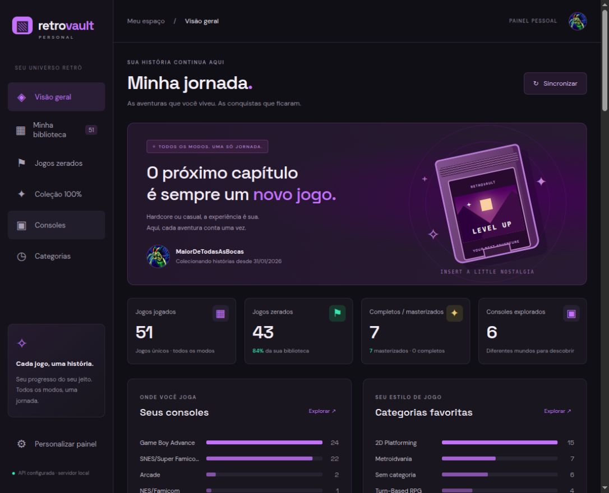

# RetroVault — RetroAchievements Personal Dashboard

RetroVault is a local, personal dashboard for exploring your RetroAchievements gaming history. It brings played games, beaten campaigns, completed achievement sets, mastered games, consoles, and genres into one collection without counting casual and hardcore progress as separate games.

The interface is currently in Brazilian Portuguese and uses a dark theme with customizable accent colors. This documentation is in English.

## Preview



*An earlier screenshot of the dashboard in use. Counts reflect the profile and counting rules at the time of capture.*

## Purpose

The project focuses on your games and the adventures you have finished. Its main goals are to:

- Count each game once, regardless of the achievement mode.
- Include only games with at least one unlocked achievement in the played library.
- Distinguish beating a campaign from completing or mastering its achievement set.
- Make your most-played consoles and genres easy to explore.
- Let you correct genre metadata and campaign completion locally.

## Features

- Overview with played, beaten, completed/mastered, and console totals.
- Game library with cover art, achievement progress, grid/list layouts, and pagination.
- Search, console and genre filters, status filters, and sorting.
- Dedicated views for beaten games, 100% sets, consoles, and categories.
- Gold badges for mastered games and separate badges for completed sets and beaten games.
- Game details with developer information, completion date, and a link to RetroAchievements.
- Local overrides for campaign completion and categories.
- Manual synchronization, background metadata loading, and persistent caching.
- Purple, green, and orange accent colors.

## Requirements

- **Node.js 22 or later**, including npm.
- Git to clone the repository.
- A RetroAchievements account and web API key.
- Internet access for synchronization, cover art, and Google Fonts.

There are no third-party npm dependencies and no build step. You do not need to run `npm install`.

## Installation

### 1. Clone the repository

```sh
git clone https://github.com/pedro-grajau/ra-personal-dashboard.git
cd ra-personal-dashboard
```

### 2. Create the environment file

On Linux or macOS:

```sh
cp .env.example .env
```

On Windows PowerShell:

```powershell
Copy-Item .env.example .env
```

Open `.env` in your editor and replace the placeholders:

```dotenv
RETRO_ACHIEVEMENTS_KEY=your_retroachievements_web_api_key
RETRO_ACHIEVEMENTS_USERNAME=your_retroachievements_username
PORT=3000
```

Get your **web API key** from your [RetroAchievements account settings](https://retroachievements.org/settings). Keep this key private. See the [official API documentation](https://api-docs.retroachievements.org/) for API access details.

### 3. Start the dashboard

Run this from the project directory:

```sh
npm start
```

Open [http://localhost:3000](http://localhost:3000) in your browser. Keep the terminal running; press **Ctrl+C** to stop the server.

When there is no cached library, the page starts the first synchronization automatically. You can also use **Sincronizar** to refresh it. The library appears before all covers and genres have finished loading.

## Configuration

| Variable | Purpose | Default |
| --- | --- | --- |
| `RETRO_ACHIEVEMENTS_KEY` | RetroAchievements web API key; required to synchronize. | None |
| `RETRO_ACHIEVEMENTS_USERNAME` | Initial profile to load before local settings exist. | The original owner's profile, currently defined in `server.mjs` |
| `PORT` | Local HTTP port. | `3000` |

Set your username explicitly during setup. Once a profile has been saved through **Personalizar painel**, `.data/settings.json` takes precedence over the environment username. Change the profile through the dashboard after that. Restart the server after changing the API key or port.

Other credentials are not required. The application only uses the RetroAchievements API key for external API requests.

## Using the dashboard

| Interface label | Meaning |
| --- | --- |
| **Visão geral** | Overview of your collection and statistics. |
| **Minha biblioteca** | All games with at least one unlocked achievement. |
| **Jogos zerados** | Games whose campaigns are beaten, including completed/mastered games. |
| **Coleção 100%** | Completed and mastered achievement sets. |
| **Consoles / Categorias** | Explore platforms and genres; click a chart label to filter games. |
| **Personalizar painel** | Change your profile or accent color. |
| **Sincronizar** | Fetch your latest progress from RetroAchievements. |

Open a game card to edit its category or campaign status. Choose **Usar status do RetroAchievements** to restore automatic campaign classification. Clear the category field to restore the API category. Separate multiple categories with commas or semicolons.

Local edits do not change your RetroAchievements account or unlock achievements.

## How statistics work

| Metric | Rule |
| --- | --- |
| **Played** | Unique game IDs with at least one unlocked achievement in either mode. Zero-unlock games are excluded from the library and every statistic. |
| **Beaten** | A `beaten-softcore`, `beaten-hardcore`, `completed`, or `mastered` award, or 100% achievement progress. A manual campaign override takes precedence. |
| **Completed** | A completion/mastery award, or all available achievements unlocked when the set has at least one achievement. |
| **Mastered** | The API explicitly reports a `mastered` award. These games receive a gold badge. |
| **Consoles** | Distinct console IDs in the filtered played library. |
| **Genres** | API `Genre` values or local overrides, split on commas/semicolons. A game counts once per genre, so genre totals may exceed the number of games. |

Casual and hardcore achievement counts overlap. RetroVault takes the larger reported count rather than adding them together, and deduplicates games by ID. The completed/mastered headline combines both groups without counting a mastered game twice. Beaten and 100% totals overlap intentionally.

Genre metadata is not standardized by this application. For example, `Collectible Card Game` and `Strategy–Trading Card Game` remain separate categories, and some games have no genre. Missing values appear as **Sem categoria**. You can standardize them with local category overrides.

The dashboard reflects data returned by RetroAchievements, not offline play or all games you have ever launched. Separate game IDs, including separate sets or versions, remain separate entries.

## Synchronization and local data

The server fetches the profile, paginated completion progress, paginated recently played games, game awards, and individual game metadata. Game detail requests run sequentially with a 500 ms delay; metadata is cached for 30 days. Manual refreshes are limited to once per minute after a library snapshot is saved.

The first synchronization may take several minutes for a large collection. If the API rejects or rate-limits requests, the dashboard displays an error and retains the data already saved. It does not automatically retry a failed synchronization.

| Location | Contents |
| --- | --- |
| `.data/dashboard.json` | Latest synchronized profile and game progress snapshot. |
| `.data/metadata.json` | Cached genres, cover paths, developer, and release data. |
| `.data/settings.json` | Saved profile and per-profile game overrides. |
| Browser local storage | Preferred accent color. |

Back up `.data/` to preserve your local edits. These files and `.env` are excluded from Git. The dashboard snapshot stores the most recently synchronized profile; game overrides are retained separately by username.

## Development and checks

```sh
# Start the server with Node's file watcher
npm run dev

# Run the game normalization and classification tests
npm test

# Check JavaScript syntax
node --check server.mjs
node --check public/app.js
```

There is no frontend hot reload. Refresh the browser after changing frontend files. See [Architecture and local API](docs/architecture.md) for implementation details.

## Troubleshooting

### The port is already in use

If you see `EADDRINUSE` or a message that port 3000 is occupied, a server is already listening there. Open its URL if it is your dashboard, or stop that instance with **Ctrl+C** before starting another.

To choose another port, set `PORT=3001` in `.env` and restart, then open [http://localhost:3001](http://localhost:3001).

### Node.js does not recognize `--env-file`

Check `node --version` and install Node.js 22 or later. Make sure your terminal uses the updated Node executable.

### The environment file is missing

Copy `.env.example` to `.env`, fill in the key and username, and run the command from the repository directory. Check that your editor did not save the file as `.env.txt`.

### Synchronization fails or the library is empty

Check the API key, exact profile name, and internet connection. For rate limits, wait a few minutes before trying again. Games without unlocked achievements are excluded by design. A valid empty library can therefore be expected for a new profile.

### Some categories are missing or inconsistent

The dashboard displays the categories returned by RetroAchievements. Edit the game category locally to correct missing metadata or group equivalent genres consistently.

## Privacy and scope

The server binds to `127.0.0.1` and is intended for use on your own computer. The API key stays on the server and is not returned to the browser. The browser loads images from RetroAchievements and fonts from Google Fonts.

This project has no user authentication and is not prepared for public hosting. Public deployment would require appropriate access protection and server-side secret configuration.

RetroVault is an independent project and is not affiliated with or endorsed by RetroAchievements.
